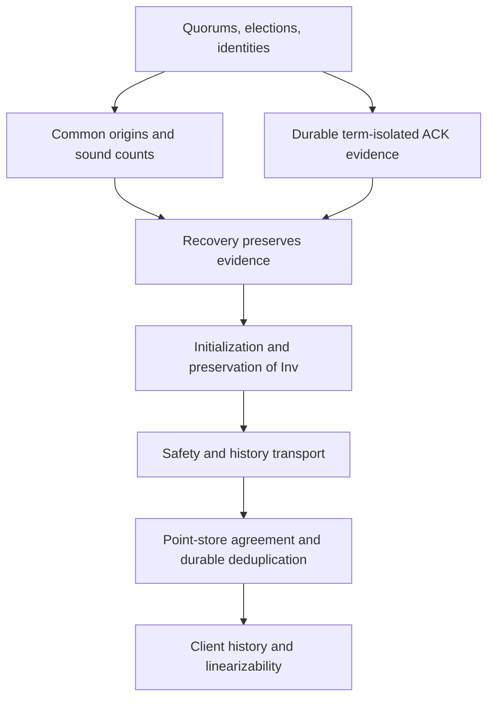

# Proof guide

Read [claims and scope](claims-and-scope.md) first. A top-level theorem is accepted only with separate successful checks of every theorem-bearing local dependency from the same frozen sources.

## Protocol induction

[TRaftInvariantDefinitions](../models/TRaftInvariantDefinitions.tla) defines `Inv == Safety /\ ProofInvariant`. This is an induction predicate, not an assumption that Safety holds in every execution. The proof establishes:

1. `ProofInit => Inv`, in [TRaftInitProof](../models/TRaftInitProof.tla).
2. `Inv /\ ProofNext => Inv'`, in [TRaftInvariantStepProof](../models/TRaftInvariantStepProof.tla), assembled from action-specific preservation lemmas.
3. Stuttering preservation in [TRaftInvariantStutterProof](../models/TRaftInvariantStutterProof.tla).
4. `ProofSpec => []Inv`, then `ProofSpec => []Safety`, in [TRaftSafetyObligations](../models/TRaftSafetyObligations.tla).

Proof predicates are not protocol-action guards. [The invariant guide](invariant-guide.md) explains their roles and the resolved induction countermodels.

## History elimination and correspondence

[TRaftHistoryRefinementProof](../models/TRaftHistoryRefinementProof.tla) reconstructs observations from protocol execution. [TRaftProtocolSafety](../models/TRaftProtocolSafety.tla) transports safety to the actual `Spec`. The history construction has independent checked dependencies; it does not assume the Safety theorem it transports.

[TRaftBoundedObserverRefinement](../models/TRaftBoundedObserverRefinement.tla) connects finite behavior and observations to the unbounded instance. [TRaftClientCoreMapping](../models/TRaftClientCoreMapping.tla) connects the client extension to the shared core. [TRaftClientSpecificationProof](../models/TRaftClientSpecificationProof.tla) establishes the client specification identity. Instance identities and aliases are machine-checked obligations.

## Application and clients

Partition rules establish commutativity of point operations within a partition. Evidence-prefix preservation and application order connect that algebraic fact to replica execution. Durable deduplication suppresses repeated abstract effects and preserves the first result. These steps close [TRaftApplicationAgreement](../models/TRaftApplicationAgreement.tla).

The client witness grows when independent commit evidence first forms. A recovery step certifying several entries orders them by index consistently with partition order. Repeated request IDs are folded once. The proof connects the witness to the sequential point store, actual call/return history, and real-time precedence. See [the client argument](client-linearizability.md).

## Mechanical navigation

The [dependency manifest](../manifests/proof-dependencies.json) and [module index](module-index.md) locate the proof. The [result index](../results/proof-modules.json) locates each independent check. Acceptance checks counts, final proved/trivial statuses, no cached obligations, input hashes, proof holes, and dependency closure.

[Diagram source](figures/proof-chain.mmd).
